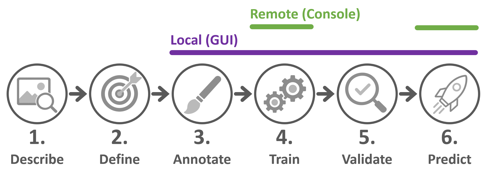

# nnWorkbench

> A GUI for nnU-Net workflows and nnInteractive-powered annotation.
> - **nnU-Net Workflow:** Train, validate and apply nnU-Net on images that already have labels.
> - **Annotation Workflow:** Extends the nnU-Net Workflow for images without labels: create the labels efficiently with nnInteractive and scribbles, then train, validate and improve the model in iterative annotation rounds.


From the first image to a trained segmentation model, nnWorkbench keeps the entire workflow in one place. It provides researchers and domain scientists with a clear workspace to inspect images in Napari, prepare or create labels, and guide an nnU-Net model from dataset preparation to prediction.

## Why nnWorkbench

- **All projects in one place:** Browse all configured nnU-Net datasets and keep each dataset’s images, labels, preprocessing, trained models, and validation results connected.
- **Guided nnU-Net from data to prediction:** Each dataset follows the nnU-Net stages Data, Preprocess, Train, Validate and Predict. Run them through short dialogs with sensible defaults, or copy the exact commands for a terminal or a cluster.
- **See what is ready and what needs attention:** Coloured stage tabs and status badges show what is done, what can run next and what must be fixed first, for example an incomplete `dataset.json` before preprocessing.
- **Inspect at every stage:** Open Raw images and labels, annotations, predictions, and validation results in Napari, with matching files loaded together whenever available.
- **Connect nnInteractive and nnU-Net:** Use nnInteractive in Napari to create annotations, save them directly as training labels in `labelsTr`, and continue with nnU-Net preprocessing and training.
- **Annotation Workflow:** Follow a documented, guided workflow designed to create high-quality labels that support model performance while minimizing manual annotation effort.


# Installation

Requirements:

- Python 3.12 or newer
- Conda or another suitable Python environment manager



Create an environment and clone the repository:

```bash
conda create -n nnworkbench python=3.12
conda activate nnworkbench
git clone <your-repository-url> nnWorkbench
cd nnWorkbench
```

## Local installation — full workbench

GUI, Napari inspection, and optional nnInteractive annotation workflow.

```bash
pip install -e ".[local]"
nnworkbench-gui
```

This works on Linux, Windows and macOS, in bash, zsh, PowerShell and the Windows command prompt. Local interactive inference additionally needs a compatible PyTorch installation.

The GUI uses Qt 6 (PySide6) by default. To use Qt 5 instead, install the GUI without a Qt binding and add PyQt5: `pip install -e ".[gui]" PyQt5`.

## Remote installation — lightweight execution

For clusters or remote machines: nnU-Net, custom trainers, and remote commands only—no GUI, Napari or nnInteractive. To run nnInteractive on a remote GPU instead, see the [napari-nninteractive documentation](https://github.com/MIC-DKFZ/napari-nninteractive).

```bash
pip install -e .
```

Save the nnU-Net roots on the remote machine once. `nnworkbench-run` then uses them for nnU-Net commands and dataset tools:

```bash
nnworkbench-set-paths --raw /path/to/nnUNet_raw --preprocessed /path/to/nnUNet_preprocessed --results /path/to/nnUNet_results
```

You can also add a remote path profile on the overview and use **Export** to copy this command with its configured paths.

# Quick start

nnWorkbench supports two workflows. The **nnU-Net Workflow** trains and applies nnU-Net on images that already have labels. The **Annotation Workflow** extends it for images without labels: you create the labels first, then continue with the same steps.

Start the GUI with `nnworkbench-gui`.

**The GUI at a glance:**

- **Overview:** the start screen with your nnU-Net folders and all datasets found in them. Select a dataset to see its details, open it to work on it.
- **Dataset page:** one tab per stage (Data, Preprocess, Train, Validate, Predict). The icon of each tab shows its state: green ✓ done, orange ring ready to run (or running), orange ! outdated, red ! must be fixed; hover over a tab for the reason.
- **On every stage:** a short how-to on the left (collapsible), what exists in the middle, and the details of your selection on the right. Runs start from the button in the stage header (on **Predict**, from the panel on the right); small (i) icons explain terms such as planner, trainer and configuration.
- **Console:** at the bottom; it runs one job at a time, shows its progress (e.g. the current epoch) and keeps the full output. **Copy command** in the run dialogs and on **Predict** gives the same command for a terminal or a cluster.

## nnU-Net Workflow

1. **Set the paths:** On the overview (the start screen), select the folders for `nnUNet_raw`, `nnUNet_preprocessed` and `nnUNet_results`. The three folders are independent: nnWorkbench combines the datasets found across all of them. For remote or terminal use, save the same paths with `nnworkbench-set-paths` as shown above.
2. **Create a dataset:** Click **New dataset**, or open an existing one from the list. Copy your images into `imagesTr` and your labels into `labelsTr` (**Open**, then **⟳ Refresh**), and fill in `dataset.json` with **Edit** on the **Data** page. Red badges on the **Data** page show what is still missing, for example labels or a matching `numTraining`.
3. **Preprocess:** On the **Preprocess** page, click **▶ Preprocess…** and then **▶ Preprocess** (`nnUNetPlannerResEncL` is preselected).
4. **Train:** On the **Train** page, click **▶ Train…**, choose one or more folds (several folds train one after another) and click **▶ Train** (`nnUNetTrainer` is preselected).
5. **Validate:** On the **Validate** page, click a finished fold of a model, click **Dice** to list the weakest cases first, and use the magnifier button (**Open in Napari**) next to a case to compare the prediction with your label.
6. **Predict:** On the **Predict** page, choose the input and output folders, the model and its finished folds, and click **▶ Predict**. The magnifier button (**Open in Napari**) opens a prediction in Napari.

## Annotation Workflow

The Annotation Workflow extends the nnU-Net Workflow: it adds annotating in Napari and uses a trainer made for sparse labels. Turn it on with the **Annotation Workflow** switch in the top bar (it applies to all datasets). Steps marked *(as in the nnU-Net Workflow)* are unchanged.

1. **Set the paths** *(as in the nnU-Net Workflow)*.
2. **Create a dataset:** Click **New dataset**, copy only your images into `imagesTr`, and add an `ignore` class with the highest ID to `dataset.json` (this makes the labels *sparse*).
3. **Annotate:** On the **Data** page, click the pencil button (**Annotate**) next to a case, annotate in Napari and click **Save annotation**. The annotation is saved directly to `labelsTr`; an empty mask is initialised with *ignore*.
4. **Preprocess** *(as in the nnU-Net Workflow)*.
5. **Train:** As in the nnU-Net Workflow; `nnUNetTrainerBetterIgnoreSampling` is preselected because `dataset.json` has an `ignore` label.
6. **Validate:** Inspect the predictions as in the nnU-Net Workflow, including the unlabeled regions. For another annotation round, select the dataset on the overview, click **＋ New iteration** and continue with step 3 in the new dataset.
7. **Predict** *(as in the nnU-Net Workflow)*.

The [nnWorkbench guide](src/nnworkbench/assets/annotation_workflow/README.md) explains both workflows step by step, with command-line alternatives; its overview shows which stages each workflow uses. It is also shown in the GUI via **? Guide** in the top bar and the guide link on every page.

## CLI overview

nnWorkbench can be used entirely through the GUI. If you prefer not to use the GUI, or are working on a remote system, the same workflows are available from the command line.

After configuring the paths with `nnworkbench-set-paths`, use `nnworkbench-run` to run any nnU-Net command with those saved paths:

```bash
nnworkbench-run nnUNetv2_plan_and_preprocess -d 42 -c 3d_fullres -pl nnUNetPlannerResEncL --verify_dataset_integrity
nnworkbench-run nnUNetv2_train 42 3d_fullres 0 -p nnUNetResEncUNetLPlans
nnworkbench-run nnUNetv2_predict -i /path/to/input -o /path/to/output -d 42 -c 3d_fullres -p nnUNetResEncUNetLPlans
```

These use the recommended `nnUNetPlannerResEncL`, which the GUI also preselects. For sparse annotations from the Annotation Workflow, add `-tr nnUNetTrainerBetterIgnoreSampling` to training and prediction.

It also provides the following dataset tools:

```bash
# Open a dataset's images, labels and annotations in Napari, starting at the 12th image
nnworkbench-run inspect -d 42 -i 12

# Analyse labelsTr and save class_distribution.json
nnworkbench-run label-analysis -d 42 --workers 4

# Convert annotations made outside nnWorkbench (annotationsTr, annotation IDs) into labelsTr
nnworkbench-run convert-annotations -d 42 --workers 4

# Stack naturally ordered 2D slices (e.g. TIFF or PNG) into one 3D NIfTI volume
nnworkbench-run stack-images /path/to/image_slices --file-type .tif --spacing 1 1 1

# Remove everything a trained model folder does not need for prediction, e.g. before sharing (in place, cannot be undone)
nnworkbench-run reduce-checkpoints /path/to/nnUNet_results/Dataset042_CellSegmentation/MODEL_FOLDER
```

`-d` (or `--dataset`) specifies the numeric nnU-Net dataset ID under the saved `nnUNet_raw` path. For example, use `-d 42` for `Dataset042_CellSegmentation`. Annotation conversion requires a valid final `ignore` label in the dataset's `dataset.json`. Run `nnworkbench-get-paths` to view the saved path configuration, and add `--help` to any tool to see all its options.

## Further documentation

- [nnWorkbench guide](src/nnworkbench/assets/annotation_workflow/README.md): the nnU-Net Workflow and the Annotation Workflow step by step; also shown in the GUI via **? Guide** in the top bar.


# Acknowledgements

<br>
&nbsp;&nbsp;&nbsp;


This repository is developed and maintained by the Applied Computer Vision Lab (ACVL)
of [Helmholtz Imaging](https://www.helmholtz-imaging.de/).
