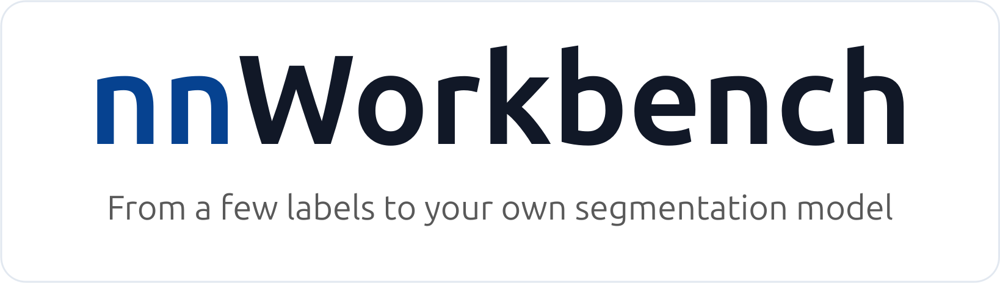
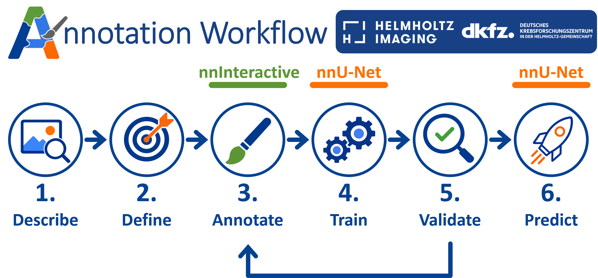
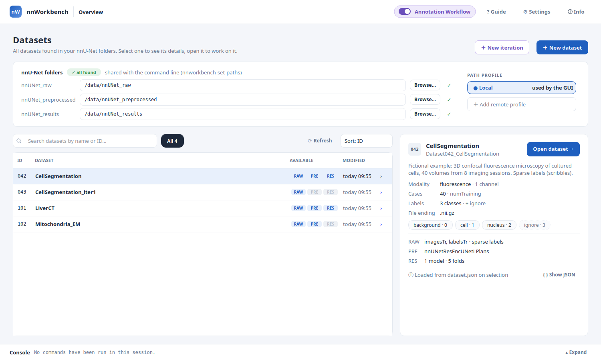
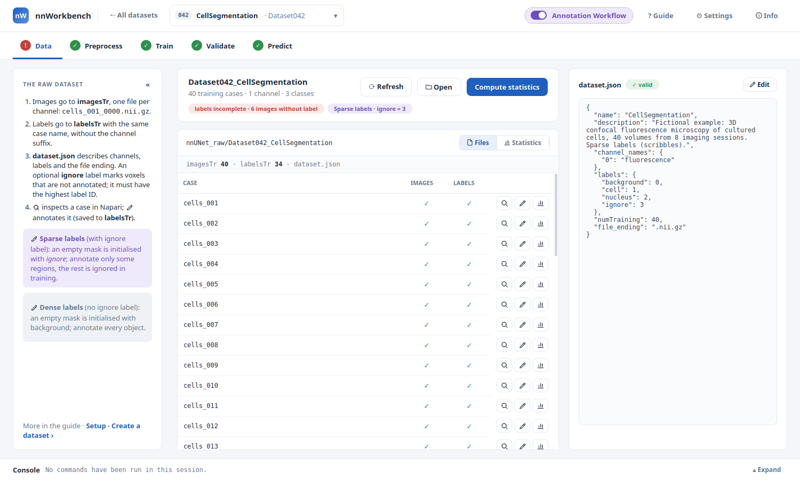

<p align="center">
  
</p>

<p align="center">
  
  
  
  <!-- CI badge once the repository is public:  -->
</p>

> A GUI for nnU-Net and nnInteractive-powered annotation that keeps the entire workflow in one place.
> - **nnU-Net Workflow:** train, validate and apply nnU-Net on images that already have labels.
> - **Annotation Workflow:** for images without labels. Create labels efficiently with nnInteractive and scribbles, then train, validate and improve the model in iterative annotation rounds.

<p align="center">
  <a href="#installation"><b>Installation</b></a> ·
  <a href="#quick-start"><b>Quick start</b></a> ·
  <a href="#cli-overview"><b>CLI</b></a> ·
  <a href="#work-with-an-ai-agent"><b>AI agents</b></a> ·
  <a href="#qa"><b>Q&amp;A</b></a> ·
  <a href="#documentation"><b>Documentation</b></a> ·
  <a href="#citation"><b>Citation</b></a> ·
  <a href="#license"><b>License</b></a>
</p>

## Why nnWorkbench

- **Everything in one place:** All your datasets with their images, labels, preprocessed data, trained models and validation results, connected in one window, from the first image to the final prediction.
- **nnInteractive and nnU-Net, connected:** Create labels with nnInteractive in Napari, save them directly as nnU-Net training data, and continue with preprocessing and training without any conversion.
- **Guidance along the way:** Each stage shows what is done, what can run next and what has to be fixed first, with a short how-to on every page and a step-by-step guide built in.
- **Inspection at every stage:** Open raw images and labels, preprocessed data, predictions and validation results in Napari, with the matching files loaded together, and find the weakest cases with one click.
- **Simple by default, full control when needed:** nnWorkbench works for users of every experience level. Short dialogs with sensible defaults get you going; planners, trainers and additional arguments are there when you need them, and every step can be copied as the exact nnU-Net command for a terminal or a cluster.

## Why Annotation Workflow

No labels yet? The Annotation Workflow gets you from raw images to a trained model with as little manual work as possible:

- **Annotate smart, not hard:** Label only parts of many images instead of everything in a few (*sparse labels*): nnInteractive outlines a whole 3D object in a few clicks, scribbles cover the rest.
- **Improve in rounds:** Train early, see where the model fails, and annotate exactly there.
- **Made for sparse labels:** A trainer bundled with nnWorkbench learns from sparse labels and is selected automatically.
- **Guided from start to finish:** A built-in guide explains every step, from defining your classes to deciding when the model is good enough.



## Installation

**Requirements:**

- **Python 3.12**
- Windows 10/11, macOS 13 or newer, or Linux with glibc 2.35 or newer (e.g. Ubuntu 22.04+)
- Conda or another Python environment manager

**From PyPI** *(coming soon: nnWorkbench is not on PyPI yet, so this does not work at the moment)*:

```bash
conda create -n nnworkbench python=3.12
conda activate nnworkbench
pip install "nnworkbench[all]"
nnworkbench-gui
```

**From source** (works now):

```bash
conda create -n nnworkbench python=3.12
conda activate nnworkbench
git clone <your-repository-url> nnWorkbench
cd nnWorkbench
pip install -e ".[all]"
nnworkbench-gui
```

Depending on your system, you may need to install PyTorch manually before installing nnWorkbench, as described on [pytorch.org](https://pytorch.org/get-started/locally/). This is required on Windows to use an NVIDIA GPU.
For a lightweight installation without the GUI on a remote machine, and for notes on using nnWorkbench on macOS, see the instructions below.

<details>
<summary><b>Windows</b></summary>

pip installs a CPU-only PyTorch on Windows, so an NVIDIA GPU would not be used. Install the CUDA build of PyTorch **before** nnWorkbench, in the activated environment:

```bash
pip install torch --index-url https://download.pytorch.org/whl/cu128
```

Then install nnWorkbench from PyPI *(coming soon: does not work at the moment)*:

```bash
pip install "nnworkbench[all]"
```

or from source (works now, inside the cloned repository):

```bash
pip install -e ".[all]"
```

The right command for your CUDA version is on [pytorch.org](https://pytorch.org/get-started/locally/). Everything works in PowerShell and the Windows command prompt.

</details>

<details>
<summary><b>macOS</b></summary>

nnWorkbench itself runs fully on macOS (13 or newer). For the GPU-heavy parts, it relies on nnU-Net and nnInteractive, which differ on Apple silicon:

- **nnU-Net (training and prediction):** runs on the Apple GPU with `-device mps` (choose **MPS** under **Device** in the Train and Predict dialogs). It works, but is much slower than an NVIDIA GPU, and the GPU shares its memory with the system: prefer `nnUNetPlannerResEncM` or `ExperimentPlanner` over `nnUNetPlannerResEncL`. A Mac is fine for predicting and short test runs; train on a GPU machine or cluster.
- **nnInteractive (annotation):** the napari-nninteractive plugin uses only CUDA GPUs, so on a Mac it runs on the CPU, which is slow. For a smooth experience, connect the plugin to an nnInteractive server on a GPU machine (see the [napari-nninteractive documentation](https://github.com/MIC-DKFZ/napari-nninteractive)).

</details>

<details>
<summary><b>Remote machines and clusters</b></summary>

On a cluster, the core installation is enough: nnU-Net, the bundled trainers and the command-line tools, without the nnWorkbench GUI, Napari or nnInteractive.

```bash
# from PyPI (coming soon, does not work at the moment)
pip install nnworkbench

# from source (works now, inside the cloned repository)
pip install -e .
```

Save the nnU-Net folders on the remote machine once:

```bash
nnworkbench-set-paths --raw /path/to/nnUNet_raw --preprocessed /path/to/nnUNet_preprocessed --results /path/to/nnUNet_results
```

`nnworkbench-run` then uses them for nnU-Net commands and dataset tools.
Optionally, you can prepare this in the nnWorkbench GUI: on the overview, add a remote path profile with the folders of the remote machine; **Export** then copies the `nnworkbench-set-paths` command above with these paths. The commands themselves can also be configured in the GUI: **Copy command** in the run dialogs gives the matching `nnworkbench-run` command, which uses the paths saved on the remote machine. All commands and dataset tools for the remote machine are listed in the [CLI overview](#cli-overview).

</details>

<details>
<summary><b>Troubleshooting</b></summary>

- **`No matching distribution found for mitk-python`:** the environment does not use Python 3.12, or the system is too old (macOS below 13, Linux with glibc below 2.35). Create the environment with `python=3.12`; on older Linux systems, use the core installation (`pip install -e .`, later `pip install nnworkbench`) without the GUI.
- **Info shows *CPU only* although there is an NVIDIA GPU:** PyTorch was installed without CUDA support or does not match the driver; Info shows the cause and the fix.
- **Qt 5 instead of Qt 6:** install the GUI without a Qt binding and add PyQt5: `pip install -e ".[gui]" PyQt5` (from PyPI, coming soon: `pip install "nnworkbench[gui]" PyQt5`).

</details>

## Quick start

Start the GUI with `nnworkbench-gui`.



1. **Set your folders.** On the start screen, select three folders: `nnUNet_raw` for your datasets (images, labels and `dataset.json`), `nnUNet_preprocessed` for the preprocessed data used in training, and `nnUNet_results` for the trained models and their validation results. nnU-Net fills the last two. Empty folders are fine. nnWorkbench lists every dataset it finds in them.
2. **Create a dataset or select an existing one.** Click **＋ New dataset**, or open a dataset from the list. Put your images into `imagesTr` (and, if you have them, your labels into `labelsTr`), and describe the classes with **Edit** next to `dataset.json`. Red badges on the **Data** page tell you what is still missing.
3. **Annotate** *(Annotation Workflow only)*. Turn on **Annotation Workflow** in the top bar. On the **Data** page, click the pencil next to an image, annotate in Napari with nnInteractive or the brush, and click **Save annotation**. Labels can be *dense* (every voxel is labelled; the mask starts as background, e.g. to segment a single organ with nnInteractive) or *sparse* (you annotate only parts of each image; the rest stays *ignore* and is not used for training). For sparse labels, add an `ignore` class with the highest ID to `dataset.json`.
4. **Preprocess.** On **Preprocess**, click **▶ Preprocess…** and then **▶ Preprocess**, or **Copy command** to run it on a remote machine. The defaults are a good start.
5. **Train.** On **Train**, click **▶ Train…**, choose the folds and click **▶ Train**, or **Copy command** to run it on a remote machine. The console at the bottom shows the progress.
6. **Validate.** On **Validate**, click a fold of your model to see its Dice score per case, sort by **Dice** to see the weakest cases first, and open any case in Napari to compare the prediction with your label.
7. **Iterate** *(Annotation Workflow only)*. Where the model is still wrong, start another annotation round: select the dataset on the start screen and click **＋ New iteration**. It copies the images and labels into a new dataset; continue there with step 3 and annotate where the model fails.
8. **Predict.** On **Predict**, choose a folder of new images and an output folder and click **▶ Predict**, or **Copy command** to run it on a remote machine.



Every page has a short how-to on the left, and **? Guide** in the top bar opens the full [nnWorkbench guide](src/nnworkbench/assets/annotation_workflow/README.md). It explains both workflows step by step: how to understand your images, define classes, annotate efficiently, read the validation results, and decide when a model is good enough.

## CLI overview

nnWorkbench can be used entirely through the GUI. If you prefer not to use the GUI, or are working on a remote system, the same workflows are available from the command line.

After configuring the paths with `nnworkbench-set-paths`, use `nnworkbench-run` to run any nnU-Net command with those saved paths:

```bash
nnworkbench-run nnUNetv2_plan_and_preprocess -d 42 -c 3d_fullres -pl nnUNetPlannerResEncL --verify_dataset_integrity
nnworkbench-run nnUNetv2_train 42 3d_fullres 0 -p nnUNetResEncUNetLPlans
nnworkbench-run nnUNetv2_predict -i /path/to/input -o /path/to/output -d 42 -c 3d_fullres -p nnUNetResEncUNetLPlans
```

These use the recommended `nnUNetPlannerResEncL`, which the GUI also preselects. For sparse annotations from the Annotation Workflow, add `-tr nnUNetTrainerBetterIgnoreSampling` to training and prediction.

It also provides the following dataset tools:

```bash
# Create a dataset with imagesTr, labelsTr and dataset.json (add --ignore for sparse labels)
nnworkbench-run create-dataset -d 42 --name CellSegmentation --labels background,cell,nucleus --ignore --channels fluorescence

# Show what is done and what is next for a dataset, and the device (GPU / MPS / CPU) (add --json for scripts)
nnworkbench-run status -d 42

# The command the GUI would prefill for preprocess, train or predict, and why each option was chosen
nnworkbench-run suggest -d 42 --step train

# Validation results: Dice per fold and class, and the weakest cases first (as the Validate page; add --json)
nnworkbench-run validation -d 42
# ... and open a validation case in Napari: image, label and prediction
nnworkbench-run validation -d 42 --open cells_017

# Open predictions with their input images in Napari
nnworkbench-run inspect-predictions /path/to/output --images /path/to/input

# Start the next annotation round: copy images, labels and dataset.json into a new dataset
nnworkbench-run new-iteration -d 42

# Open a dataset's images and labels in Napari, starting at a case (or -i 12 for the 12th image)
nnworkbench-run inspect -d 42 --case cells_012

# Annotate a case in Napari with nnInteractive (as the pencil in the GUI; saves to labelsTr)
nnworkbench-run annotate -d 42 --case cells_012

# Compute statistics (as on the Data page): classes per image and voxels per class, from labelsTr
nnworkbench-run compute-statistics -d 42 --workers 4

# Stack naturally ordered 2D slices (e.g. TIFF or PNG) into one 3D NIfTI volume
nnworkbench-run stack-images /path/to/image_slices --file-type .tif --spacing 1 1 1

# Remove everything a trained model folder does not need for prediction, e.g. before sharing (in place, cannot be undone)
nnworkbench-run reduce-checkpoints /path/to/nnUNet_results/Dataset042_CellSegmentation/MODEL_FOLDER --yes
```

Add `--json` to any tool that returns a result for machine-readable output, e.g. for scripts or agents. Steps that cannot be undone ask for confirmation: `reduce-checkpoints` and training a fold that already has results need `--yes`; add `--dry-run` to see what would happen without changing anything. `-d` (or `--dataset`) specifies the numeric nnU-Net dataset ID under the saved `nnUNet_raw` path. For example, use `-d 42` for `Dataset042_CellSegmentation`. Run `nnworkbench-get-paths` to view the saved path configuration, and add `--help` to any tool to see all its options.

## Work with an AI agent

nnWorkbench is ready for AI coding agents such as Claude Code or Codex. Open the repository (or your working folder with it) in
the agent and describe your goal, e.g. *"Help me train a model that segments the nuclei in my microscopy images in
/data/images."* The agent follows [AGENTS.md](AGENTS.md): it asks about your images and labels in plain words, sets
up the dataset, runs preprocessing and training, and summarises the results. You do what needs your eyes and
expertise: it opens the images for you to annotate and the predictions for you to check, and continues when you are
done.

## Q&A

<details>
<summary><b>Do I need a GPU?</b></summary>

For training, an NVIDIA GPU is strongly recommended; on the CPU, training takes days per fold. Everything else (managing datasets, annotating, inspecting, validating, predicting) also works without one. **Info** (top right in the GUI) shows which device was found.

</details>

<details>
<summary><b>I already use nnU-Net. Can I use my existing datasets and models?</b></summary>

Yes. nnWorkbench works directly on the standard nnU-Net folders: choose your existing `nnUNet_raw`, `nnUNet_preprocessed` and `nnUNet_results` on the start screen, and all datasets, plans and trained models appear. Nothing is converted or moved.

</details>

<details>
<summary><b>Are my data and trained models still compatible with nnU-Net?</b></summary>

Yes. Datasets, preprocessed data and models stay in the standard nnU-Net folders and formats, and every step runs a regular nnU-Net command, so you can continue with nnU-Net alone at any time. Models trained with the bundled `nnUNetTrainerBetterIgnoreSampling` need this trainer for prediction: use `nnworkbench-run nnUNetv2_predict …`, or make the model usable with plain nnU-Net via `nnworkbench-run reduce-checkpoints MODEL_FOLDER --reset-trainer-name --yes`, which removes what prediction does not need and sets the trainer to `nnUNetTrainer`.

</details>

<details>
<summary><b>Can I train on a cluster and keep working in the nnWorkbench GUI on my computer?</b></summary>

Yes. Use the core installation on the cluster (see *Remote machines and clusters* above) and copy the commands from the GUI (see the [CLI overview](#cli-overview)). If the cluster's `nnUNet_results` folder is mounted on your computer, the GUI shows the training progress and the validation results as if they ran locally.

</details>

<details>
<summary><b>Where does my data have to be for a remote setup?</b></summary>

Each step needs the folder written by the previous one on the machine that runs it: preprocessing needs `nnUNet_raw`, training needs `nnUNet_preprocessed`, and prediction needs the model in `nnUNet_results`. The GUI on your computer uses `nnUNet_raw` for annotating and `nnUNet_results` for validation. The simplest setup is storage both machines can access, e.g. a mounted network drive; otherwise copy `nnUNet_raw` to the remote machine after each annotation round and copy `nnUNet_results` back.

</details>

<details>
<summary><b>Which file formats are supported?</b></summary>

The formats nnU-Net reads: for 3D images `.nii.gz` / `.nii` (recommended), `.nrrd`, `.mha`, `.gipl` and `.tif` / `.tiff`; for 2D images `.png`, `.bmp` and `.tif`. JPEG is not supported, because its lossy compression alters the images. All images and labels of a dataset use the same file ending, set in `dataset.json`. A folder of 2D slices can be combined into one 3D volume with `nnworkbench-run stack-images` (see the [CLI overview](#cli-overview)); more in the guide under [Prepare Your Images](src/nnworkbench/assets/annotation_workflow/setup.md#prepare-your-images-optional).

</details>

<details>
<summary><b>Does nnWorkbench work with 2D images?</b></summary>

Yes. The nnU-Net Workflow works the same for 2D and 3D images. The Annotation Workflow also works with 2D images, but annotate them with scribbles (the brush in Napari): nnInteractive does not work on 2D images. Preprocessing, training, validation and prediction with nnU-Net work in any case.

</details>

<details>
<summary><b>Can I annotate with nnInteractive without a local GPU?</b></summary>

Yes. nnInteractive can run on a server with a GPU, while you annotate in Napari on your computer. Set up the server and connect the plugin as described in the [napari-nninteractive documentation](https://github.com/MIC-DKFZ/napari-nninteractive). Without a GPU or a server, nnInteractive runs on the CPU, which is slow (on a Mac always, see *macOS* above).

</details>

## Documentation

The **[nnWorkbench guide](src/nnworkbench/assets/annotation_workflow/README.md)** explains both workflows step by step, with the matching command for each step. It is also built into the GUI: **? Guide** in the top bar and **More in the guide ›** on every page.

- **[Setup](src/nnworkbench/assets/annotation_workflow/setup.md):** nnU-Net folders, remote machines, creating a dataset and `dataset.json`.
- **[1. Describe](src/nnworkbench/assets/annotation_workflow/1-describe.md)** and **[2. Define](src/nnworkbench/assets/annotation_workflow/2-define.md):** understanding your images, defining classes, dense or sparse labels.
- **[3. Annotate](src/nnworkbench/assets/annotation_workflow/3-annotate.md):** annotating efficiently with nnInteractive and scribbles.
- **[4. Train](src/nnworkbench/assets/annotation_workflow/4-train.md):** preprocessing, planners and GPU memory, trainers, folds and device.
- **[5. Validate](src/nnworkbench/assets/annotation_workflow/5-validate.md):** inspecting predictions, metrics, typical errors and the next annotation round.
- **[6. Predict](src/nnworkbench/assets/annotation_workflow/6-predict.md):** applying and sharing a trained model.

**For AI agents:** [AGENTS.md](AGENTS.md) guides an agent (e.g. Claude Code or Codex) through the whole process with CLI commands, and tells it where you take over (annotating, looking at results).

**Underlying tools:**

- **[nnU-Net](https://github.com/MIC-DKFZ/nnUNet)** and its **[documentation](https://github.com/MIC-DKFZ/nnUNet/tree/master/documentation):** dataset format, planners, trainers and everything below nnWorkbench.
- **[nnInteractive](https://github.com/MIC-DKFZ/nnInteractive):** the interactive 3D segmentation model behind the annotation.
- **[napari-nninteractive](https://github.com/MIC-DKFZ/napari-nninteractive):** the Napari plugin for nnInteractive, including an nnInteractive server for annotating without a local GPU.

## Citation

nnWorkbench builds on nnInteractive and nnU-Net. If it helps your research, please cite the methods you used. A citable reference for nnWorkbench itself will follow with the first release.

**nnInteractive** (annotation):

> Isensee, F.\*, Rokuss, M.\*, Krämer, L.\*, Dinkelacker, S., Ravindran, A., Stritzke, F., Hamm, B., Wald, T., Langenberg, M., Ulrich, C., Deissler, J., Floca, R., & Maier-Hein, K. (2025). nnInteractive: Redefining 3D Promptable Segmentation. https://arxiv.org/abs/2503.08373 \
> \*: equal contribution

**nnU-Net** (preprocessing, training and prediction):

> Isensee, F., Jaeger, P. F., Kohl, S. A., Petersen, J., & Maier-Hein, K. H. (2021). nnU-Net: a self-configuring method for deep learning-based biomedical image segmentation. Nature Methods, 18(2), 203-211.

**nnU-Net Revisited** (the residual encoder planners, including the default `nnUNetPlannerResEncL`):

> Isensee, F., Wald, T., Ulrich, C., Baumgartner, M., Roy, S., Maier-Hein, K., & Jaeger, P. F. (2024). nnU-Net Revisited: A Call for Rigorous Validation in 3D Medical Image Segmentation. MICCAI 2024. https://arxiv.org/abs/2404.09556


## License

nnWorkbench is licensed under the [Apache License 2.0](LICENSE).

> **Note:** The [nnInteractive model weights](https://huggingface.co/MIC-DKFZ/nnInteractive), downloaded on first use
> for interactive annotation, are licensed under
> [CC BY-NC-SA 4.0](https://creativecommons.org/licenses/by-nc-sa/4.0/): **non-commercial use only**. nnU-Net and the
> rest of nnWorkbench are not affected.

## Acknowledgements

<p>
  
  &nbsp;&nbsp;&nbsp;&nbsp;
  
</p>

This repository is developed and maintained by the Applied Computer Vision Lab (ACVL)
of [Helmholtz Imaging](https://www.helmholtz-imaging.de/).
