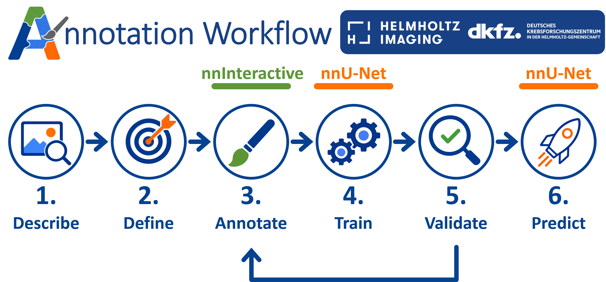

This guide is for users who have images but need to create labels before training nnU-Net.

## Prerequisites

The Annotation Workflow is optional. Enable it in the header with the **Annotation workflow** switch. When disabled, annotation-specific actions are hidden while the normal nnU-Net workflow remains available.

For local nnInteractive inference, install and configure a compatible PyTorch environment and nnInteractive model in addition to nnWorkbench’s dependencies.

Your Raw dataset needs `imagesTr` and `dataset.json`. Enable the workflow before creating a new dataset if you want nnWorkbench to create `annotationsTr` for it.

## Annotation IDs

nnInteractive semantic maps reserve value `0` for ignored voxels. In the Napari saving panel, nnWorkbench translates the dataset labels for annotation:

- `ignore` is shown as annotation ID `0`.
- Every other dataset label ID is shown with `+1`.

For example, `background: 0`, `tumour: 1`, `ignore: 2` in `dataset.json` becomes annotation IDs `1: background`, `2: tumour`, and `0: ignore`.

Before conversion, the Raw `dataset.json` must contain an integer `ignore` label with the highest ID. nnWorkbench highlights an invalid label table and explains the problem when Annotation Workflow is enabled.

## Create or edit an annotation

In Raw, expand `imagesTr` and choose **Annotate** for an image. To continue a saved case, expand `annotationsTr` and choose **Edit**. Both actions open the same Napari annotation session.

Napari loads the image and starts nnInteractive with semantic-map aggregation enabled. nnWorkbench’s saving panel sits above the nnInteractive controls and shows the active annotation layer and the translated annotation IDs.

The semantic map is named `semantic map - <image-layer-name>`. If no saved map exists, nnWorkbench creates a writable zero-filled semantic layer with the image’s geometry. Existing annotation data is copied before editing because MITK exposes read-only array views.

Use **Save annotation** to write the semantic map to `annotationsTr`. The file uses the nnU-Net case name: `Case_001_0000.nii.gz` saves as `annotationsTr/Case_001.nii.gz`. Use **Close Napari (Ctrl+C)** or `Ctrl+C` to close the window.

## Convert annotations to training labels

Choose **Convert Annotations** in Raw once annotations are ready. The action is visible only when Annotation Workflow is enabled and is enabled only when `annotationsTr` contains annotation files.

Conversion runs in the background and uses the same worker-process setting as **Analyze Labels**. For every valid annotation map:

- annotation value `0` becomes the highest `ignore` ID from `dataset.json`;
- positive annotation values are shifted down by one;
- the converted map replaces the matching file in `labelsTr` while preserving image geometry.

Empty maps and maps with values outside the valid annotation range are skipped and reported; the remaining cases continue to convert.

## Inspect and analyze

Use **Inspect** on images, labels, or annotations to open available matching files in Napari. When viewing images without a matching annotation, no stale annotation layer is retained.

After conversion, use **Analyze Labels** to calculate class presence and voxel counts. The saved `class_distribution.json` can be reopened later from the Raw tree without recomputing.

## Train with annotation-aware sampling

When Annotation Workflow is enabled, train with an `nnUNetTrainerBetterIgnoreSampling` variant.

These trainers are designed for incomplete annotations. They place annotated structures at different positions within training patches instead of always centring them. This gives the model more varied examples and helps reduce errors near patch borders.

Choose the variant that matches the augmentation policy you need:

- `nnUNetTrainerBetterIgnoreSampling` — recommended default.
- `nnUNetTrainerBetterIgnoreSamplingDA5` — use the nnU-Net DA5 augmentation policy.
- `nnUNetTrainerBetterIgnoreSamplingDA5ord0` — use DA5 order-0 augmentation.
- `nnUNetTrainerBetterIgnoreSamplingOnlyMirror01` — mirror only axes 0 and 1.
- `nnUNetTrainerBetterIgnoreSamplingNoMirroring` — disable mirroring augmentation.
- `nnUNetTrainerBetterIgnoreSampling_10epochs` — short debugging run.

Select one in **Preprocessed → Run Training**. The variants are bundled with nnWorkbench and are made available to the nnU-Net command automatically when training is started from the GUI.

For commands started outside the GUI, save the three nnU-Net paths once, then use the getter to display them together with the bundled trainer directory:

```bash
nnworkbench-set-paths --raw /path/to/nnUNet_raw --preprocessed /path/to/nnUNet_preprocessed --results /path/to/nnUNet_results
nnworkbench-get-paths
```

To run nnU-Net with those saved paths in a terminal or scheduler job, prefix the command with `nnworkbench-run`:

```bash
nnworkbench-run nnUNetv2_train 1 3d_fullres 0
```

The annotation-specific tools are available through the same command:

```bash
nnworkbench-run convert-annotations 1 --workers 4
nnworkbench-run label-analysis 1
```

## Continue with nnU-Net

Once annotations have been converted and reviewed as `labelsTr`, follow the [nnU-Net workflow guide](nnunet-workflow.md) to preprocess, train, validate, and predict.
