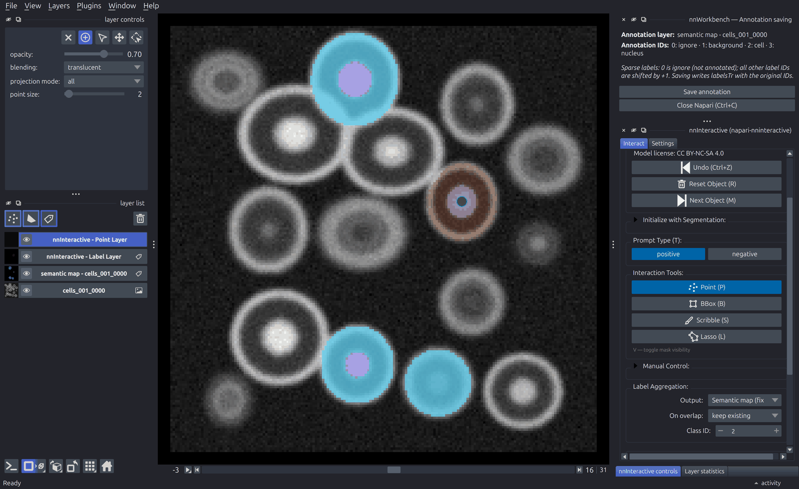
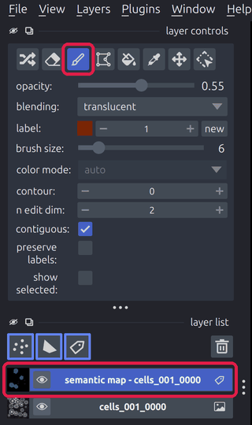
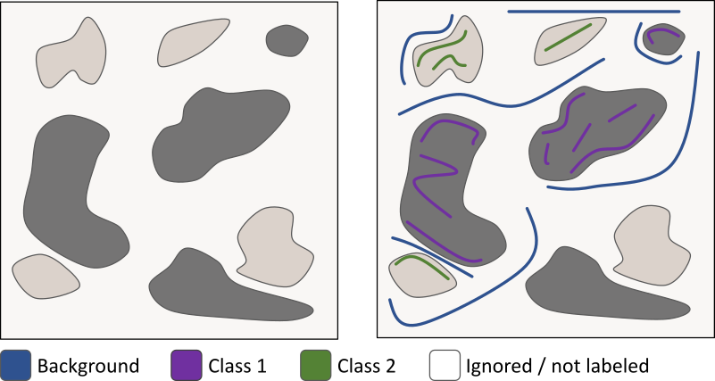

# 3. Annotate

***Minimize the annotation effort while maximizing model performance.***

## TL;DR

- Annotate small, representative regions in many different images rather than large regions in a few.
- Label all classes, including the background, roughly balanced and next to each other.
- Use [nnInteractive](#nninteractive) for 3D objects and [scribbles](#scribble-annotations) otherwise, but stick to one method per class.
- **In nnWorkbench:** Click the pencil button (**Annotate**) next to a case on the **Data** page and click **Save annotation**. The annotation is saved directly to `labelsTr`; no conversion is needed.

**nnInteractive:** An interactive segmentation method which can generate 3D instance segmentation masks from simple 2D user input like clicks, boxes, lasso or scribbles.

Links: [Paper](https://arxiv.org/abs/2503.08373) | [Code](https://github.com/MIC-DKFZ/nnInteractive) | [Napari Integration](https://github.com/MIC-DKFZ/napari-nninteractive) (built into nnWorkbench) | [MITK Integration](https://www.mitk.org/) (a separate application, not integrated in nnWorkbench)

> **Note:** The [nnInteractive model weights](https://huggingface.co/MIC-DKFZ/nnInteractive), downloaded on first use, are licensed under [CC BY-NC-SA 4.0](https://creativecommons.org/licenses/by-nc-sa/4.0/): **non-commercial use only**. Scribble annotations, nnU-Net and the rest of nnWorkbench are not affected.

## Annotation Principles

Since we want to minimize the annotation effort, the labels we generate should contain as much information as possible and should have the highest possible quality. To do so, follow these principles:

**Diversity:** To help the model generalize well for your data, capture the natural variability in your dataset, such as:

- *Image-level variability:* differences in contrast, brightness, noise, resolution, artifacts, background, and acquisition conditions.
- *Class-level variability:* differences in object size, shape, appearance, orientation, position, and context.

**Consistency:** Apply the same annotation criteria throughout the entire dataset. Similar structures or objects should always be labeled in the same way to provide the model with reliable training examples. The better you define your classes in [stage 2](2-define.md), the easier it is to label them consistently.

**Balance:** Ensure that all classes are represented by a sufficient and reasonably balanced number of annotations whenever possible. This helps prevent the model from becoming biased toward more frequently annotated classes.

> **Note:** A dense 3D mask (from e.g. nnInteractive) contains much more information than a sparse scribble annotation. Therefore, many more scribble annotations are typically required to achieve comparable coverage.

## Annotation Instruction

### Image Selection

To capture the diversity of the dataset, distribute annotations across as many different images as possible. Annotating small regions in several images is usually more valuable than annotating one large region in a single image. Random image selection is often a good starting point. If some classes, image types, or difficult cases are underrepresented, manually select additional images to correct the imbalance.

### Region Selection

Loosely cluster annotations within each image. Whenever possible, annotate nearby objects from different classes so the model can learn how to distinguish between them. Two classes next to each other provide more information than an isolated class. Also, here random region selection is often a good starting point. For example, select a random slice index and annotate structures in and around that slice. Again, if some classes, regions, or difficult cases are underrepresented, manually select additional areas to correct the imbalance.

### Class Selection

In most datasets, there is no natural class balance, meaning that some classes occur much more frequently than others. Try to roughly balance the classes you annotate. You do not need to count voxels. If some classes are very rare, manually select regions containing these classes. When doing so, also annotate the surrounding classes so the model can learn to distinguish them. Ideally, each annotated image should contain examples of all classes. There are also situations where an intentional imbalance is beneficial, for example if some classes are much more complex or variable than others and therefore require more training examples.

### Method Selection

nnInteractive is not required for this workflow, but highly recommended, because it greatly reduces the annotation effort. Use it to generate 3D annotations whenever possible. nnInteractive is suitable when all of the following conditions are met:

- Your data is 3D.
- The target class consists of individual, separable objects (e.g., individual cells) since nnInteractive is doing instance segmentation.
- The objects are not excessively large; otherwise, the runtime of nnInteractive will increase drastically and is not feasible anymore.
- nnInteractive is able to produce meaningful segmentations for the objects in this class (trial and error).

If nnInteractive cannot be applied or does not produce satisfactory results, use scribble annotations as a fallback. Typically this is the case for at least the background class.

nnWorkbench annotates in Napari, which supports both nnInteractive and scribble annotations with the brush tool ([MITK](https://www.mitk.org/) offers the same outside nnWorkbench; see [Q&A](#qa) for other software). You can therefore combine both methods within the same annotation mask, for example nnInteractive for cells and scribbles for the background. Within one class, however, stick to one method (see [Q&A](#qa)).

### Annotation IDs

The IDs you paint with depend on whether your labels are sparse or dense, i.e. whether `dataset.json` has an `ignore` label (see [Dense or Sparse Labels](2-define.md#dense-or-sparse-labels)). nnWorkbench shows the right IDs in the **nnWorkbench — Annotation saving** panel either way.

**Sparse labels (with an ignore label):** Every voxel you have not labeled must stay recognizable as unlabeled. The ID 0 is the most convenient choice for this: it is displayed as transparent, so unlabeled areas stay clear and you keep a good overview of what you have already annotated. Therefore, while annotating, Ignore gets the annotation ID 0 and all class IDs from [2. Define](2-define.md) are shifted up by one. This applies to both annotation methods, nnInteractive and scribbles.

| Class | Original ID (`dataset.json`, `labelsTr`) | Annotation ID (while annotating) |
| --- | --- | --- |
| Ignore | 3 | 0 |
| Background | 0 | 1 |
| Cell | 1 | 2 |
| Nucleus | 2 | 3 |

*(IDs for the Dataset042 example.)*

**Dense labels (no ignore label):** No ignore label is needed and nothing is shifted: you paint with the IDs from `dataset.json`, and a new annotation starts as Background (ID 0), so every voxel you do not paint is background. Use this when you label every object of an image, e.g. a single organ segmented with nnInteractive.

With sparse labels, the annotation IDs must be converted back to the original IDs before training. nnWorkbench does this mapping for you: it shows the annotation IDs in the **nnWorkbench — Annotation saving** panel while you annotate, and writes the original IDs to `labelsTr` when you save.

### nnInteractive

nnInteractive creates instance segmentations, meaning that individual objects are segmented one by one. Since we later train a semantic segmentation model, the individual object masks are combined into a semantic map in which all objects belonging to the same class share the same class ID.

**In general** (Napari or MITK):

- Enable the semantic map output in the **Label Aggregation** box.
- Select the image you want to annotate.
- Initialize nnInteractive.
- For each object you want to segment:
  - Check the class ID in **Label Aggregation** and set it to the correct class before starting.
  - Select an interaction type, such as a point, box, scribble, or lasso, and place it in the image.
  - Add further interactions until the segmentation is satisfactory.
  - When nnInteractive produces only a partly correct result, switch to the brush tool and manually correct the segmentation. Do this only as a last step and don't add interactions to this object afterwards.
  - Click **Next Object** and repeat the process.
- You can also add scribbles directly to the output segmentation layer while working. See the [scribble annotation instructions](#scribble-annotations) below.

**In nnWorkbench:**

- On the **Data** page, click the pencil button (**Annotate**) next to a case. The same button continues a saved annotation.
- Napari opens with the image, its semantic map (empty or previously saved) and the nnInteractive controls, with the semantic map output already enabled.
- Initialize nnInteractive and segment each object as described above. Use the [annotation IDs](#annotation-ids) listed in the **nnWorkbench — Annotation saving** panel.
- Click **Save annotation**. The semantic map is saved to `labelsTr` with the correct filename and the original IDs. **Close Napari (Ctrl+W, on macOS Cmd+W)** closes the window when you are done.

*Annotating `cells_001` of the Dataset042 example (sparse labels). nnInteractive is initialized and **Point (P)** is selected: a positive point on the next cell gives its prediction (brown). **Label Aggregation** writes it to the semantic map with **Class ID** 2 (cell) when you click **Next Object**. Cells annotated before are blue (cell, ID 2) with purple nuclei (nucleus, ID 3); everything else is still unlabeled (ID 0, Ignore).*

> **Tip:** With **On overlap: keep existing**, labels already in the semantic map are not overwritten. Segment the nuclei first (Class ID 3) and then the cells around them (Class ID 2): the nuclei stay nucleus.

### Scribble Annotations

**Scribble annotations:** Scribble annotations are lines/scribbles drawn directly on clearly identifiable structures in an image, typically with some kind of brush tool. Instead of marking the complete structure, you label only a few representative areas, while everything else remains unlabeled.

Besides the general annotation principles and selection strategies, follow these guidelines for effective scribble annotations:

- **Label all classes.** Provide enough representative examples for the model to learn how the classes differ from one another. Depending on their diversity and complexity, some classes may require more annotations than others.
- **Keep scribbles inside the target structure.** Scribbles that cross into another class can confuse the model.
- **Annotate near class boundaries.** Place scribbles close to borders so the model can learn where one class ends and another begins. However, do not focus only on boundaries, also include representative areas within each class.
- **Label neighboring classes together.** When two classes touch, place scribbles on both sides of the boundary.
- **Be efficient.** Scribbles do not need pixel-perfect precision. A few well-placed strokes usually provide the best balance between annotation effort and segmentation quality.
- **Don't forget the background.** This is also a class we have to label, so don't forget to add enough background annotations. Otherwise, the model may not learn boundaries of other classes accurately, resulting in fuzzy or imprecise borders.

**In nnWorkbench:** Open the case with the pencil button as described [above](#nninteractive). The brush is Napari's own tool, not part of the nnInteractive controls:

1. In the **layer list**, select the semantic map layer (`semantic map - <case>`).
2. In the **layer controls**, click the brush button (or press `2`).
3. Set **label** to the [annotation ID](#annotation-ids) of the class, as listed in the saving panel, and adjust the **brush size**.
4. Paint the scribbles, then click **Save annotation**.

**Example scribble annotations:**

### Q&A

**How much data do I have to label?**
There is no general answer to this question. The number of annotations needed for each class depends on the diversity of the data and the complexity of the segmentation task. In general, more representative training examples improve the model, so when in doubt, add a few more.

**How many iterations do I need?**
Stop when you are satisfied with the results. When additional annotations produce only minor improvements, the model may be approaching its current performance limit. Achieving better results could then require a much larger annotation effort, so consider whether the expected gain is worth the investment. Before stopping, make sure the plateau is not caused by systematic annotation errors, inconsistent class definitions, or underrepresented failure cases.

**How to balance the number of annotations and the number of iterations?**
If annotation time is limited, it can be useful to work with smaller annotation batches and retrain more often. This gives you more frequent feedback and helps you focus new annotations on the cases where the model still struggles. If compute time is more limited, it may be better to collect a larger set of annotations before retraining and therefore use fewer iterations.

**Can I use other annotation methods or software?**
Yes. Other annotation methods and software can also be used, and for some types of data or structures they may even be more suitable. However, use them carefully and make sure they do not introduce systematic biases, for example by favoring certain object sizes, shapes, or easier cases. The annotations should remain representative, consistent, and follow the same class definitions and labeling rules throughout the dataset. Use the same annotation method for all annotations of one class: different methods produce different boundaries (e.g. a nnInteractive mask vs. hand-drawn scribbles), and mixing them within a class makes its labels inconsistent. Save such labels directly in `labelsTr`, with the same filename as the image but without the `_0000` channel suffix, and with the original label IDs from `dataset.json` (for sparse labels, Ignore for every unlabeled voxel).

**Reference:** Isensee, F.\*, Rokuss, M.\*, Krämer, L.\*, Dinkelacker, S., Ravindran, A., Stritzke, F., Hamm, B., Wald, T., Langenberg, M., Ulrich, C., Deissler, J., Floca, R., & Maier-Hein, K. (2025). nnInteractive: Redefining 3D Promptable Segmentation. (\*: equal contribution)

---

[← 2. Define](2-define.md) | [Overview](README.md) | [4. Train →](4-train.md)
