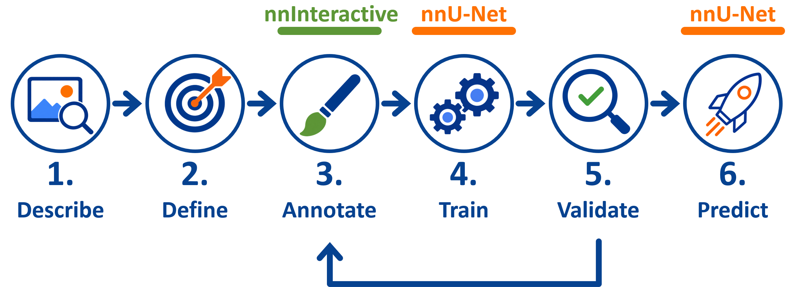
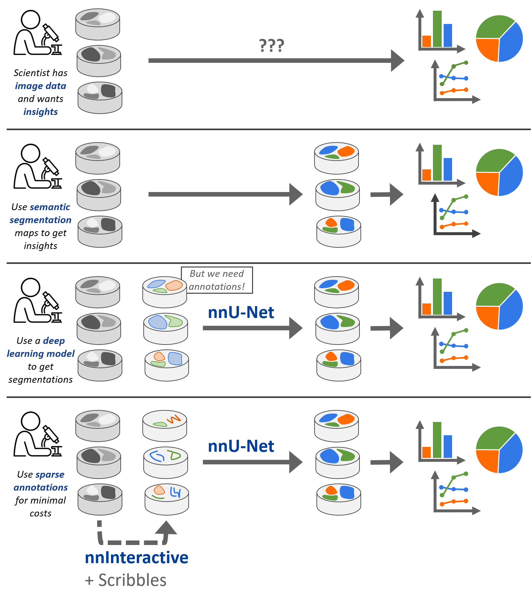

# nnWorkbench Guide

This guide explains how to train and apply nnU-Net segmentation models with nnWorkbench (**nnU-Net Workflow**), and how to create the labels for them from scratch (**Annotation Workflow**).

- **nnU-Net Workflow** (you already have labels): Use nnWorkbench to train and apply nnU-Net. Follow [Setup](setup.md), then [4. Train](4-train.md), [5. Validate](5-validate.md) and [6. Predict](6-predict.md). [1. Describe](1-describe.md) and [2. Define](2-define.md) are optional, but help to understand your data and task.
- **Annotation Workflow** (you have images, but no labels yet): Extends the nnU-Net Workflow. After following [Setup](setup.md), you first create the labels in stages 1 to 3, then continue with the same stages 4 to 6.

| Stage | Goal | nnU-Net Workflow | Annotation Workflow |
| --- | --- | :---: | :---: |
| [Setup](setup.md) | Organize your data for a smooth and structured workflow. | ✅ | ✅ |
| [1. Describe](1-describe.md) | Understand the full range of your image data and the structures you are interested in. | 🟡 | ✅ |
| [2. Define](2-define.md) | Define your task precisely and resolve all ambiguities. | 🟡 | ✅ |
| [3. Annotate](3-annotate.md) | Minimize the annotation effort while maximizing model performance. | ❌ | ✅ |
| [4. Train](4-train.md) | Turn your labels into an automated segmentation model. | ✅ | ✅ |
| [5. Validate](5-validate.md) | Decide if your model is ready or not. | ✅ | ✅ |
| [6. Predict](6-predict.md) | Release the model and use it in the wild. | ✅ | ✅ |

✅ required · 🟡 optional · ❌ not used

In the Annotation Workflow, stages 3 to 5 form a loop: based on the validation results, either return to Stage 3 for another iteration or continue to Stage 6. An iteration is one pass of annotating, training and validating; each starts as a new dataset with **＋ New iteration**.

**In nnWorkbench:** The stages map to the pages of a dataset: Setup to the overview and the **Data** page, 3. Annotate to the pencil button (**Annotate**) on the **Data** page, 4. Train to the **Preprocess** and **Train** pages, 5. Validate to **Validate** and 6. Predict to **Predict**. 1. Describe and 2. Define happen outside the app. The icon on each page tab shows its state: green ✓ done, orange ring ready to run (or running), orange ! outdated, red ! must be fixed; hover over a tab for the reason. **More in the guide · …** at the bottom of each page opens the matching section of this guide.

## What You Need

### Both Workflows

**Image data.** 2D or 3D images from any imaging modality, such as CT, MRI or microscopy. The structures of interest must be visible: if a human expert cannot recognize them precisely in the images, it is unlikely the model can learn them.

**A semantic segmentation task.** nnU-Net trains a *semantic* segmentation model: it works on pixel (2D) or voxel (3D) level, not on object level. Every pixel or voxel is assigned a class, such as *cell*, *nucleus* or *background*. If you need individual objects, non-touching objects can later be separated from the semantic segmentation mask, e.g. with a connected-component analysis.

**Access to a GPU.** Training nnU-Net needs a GPU with 8 to 40 GB of memory, depending on the model size (24 GB for the recommended setup, see [Planners and GPU Memory](4-train.md#planners-and-gpu-memory)). The GPU does not have to be in your local machine: training can also run on a remote machine or cluster, while you work locally in nnWorkbench.

**Time.** Training one fold takes hours to days, depending on the planner and the GPU (see [Planners and GPU Memory](4-train.md#planners-and-gpu-memory)).

### nnU-Net Workflow

**Labels.** A semantic segmentation mask for each training image: an image of the same size in which every pixel or voxel holds its class ID, numbered continuously from 0. Each mask is named like its image, without the channel suffix (`_0000`).

### Annotation Workflow

**Time for annotating.** You create the labels yourself, usually in several iterations of annotating, training and validating. Knowledge of the structures in your images is essential.

**nnInteractive (optional).** nnInteractive is not required, but highly recommended: it greatly reduces the annotation effort. It only works on 3D images; for 2D images, you annotate with scribbles. It needs a GPU with about 10 GB of memory, locally or on a remote machine.

## About the Annotation Workflow

***Turn scientific images into quantitative insights.***

Scientific images contain valuable quantitative information, but extracting it often requires segmentation of the structures of interest. The Annotation Workflow provides a practical way to turn expert knowledge into automatic image segmentations while keeping annotation effort as low as possible. The process starts by organizing and understanding the data, defining clear classes, and creating representative annotations. Annotation effort is minimized by combining [nnInteractive](3-annotate.md#nninteractive) and [scribble annotations](3-annotate.md#scribble-annotations). These annotations are then used to train [nnU-Net](4-train.md), a self-configuring method for automatic image segmentation. The workflow is iterative: predictions are reviewed, failure cases are identified, and additional annotations are added where they are most useful. Once the results are sufficient, the trained model can be applied to new images to generate segmentations automatically for downstream scientific analysis.

---

[Setup →](setup.md)
